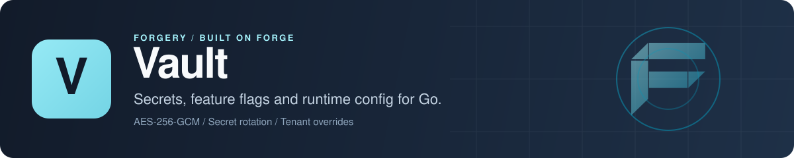

<p align="center">
  
</p>

# Vault: secrets management, feature flags and runtime config for Go

Vault is a Go library for encrypted secrets management, feature flags and hot-reloadable runtime configuration, with per-tenant overrides, secret rotation and an audit log on top. You import it, bring your own database and an AES-256 key, and keep control of your process. It's meant for multi-tenant backends that want all three behind one API, and it plugs into [Forge](https://github.com/xraph/forge) as an extension, or into [Confy](https://github.com/xraph/confy) as a config source.

[](https://go.dev/dl/) [](https://github.com/xraph/vault/actions/workflows/ci.yml) [](https://pkg.go.dev/github.com/xraph/vault) [](https://github.com/xraph/vault/stargazers)

[Documentation](https://www.xraph.com/docs/vault) · [Quick start](#quick-start) · [Features](#why-vault) · [Secrets](#secrets) · [Feature flags](#feature-flags) · [Runtime config](#runtime-config) · [Forge](#use-it-with-forge) · [FAQ](#faq)

## Quick start

You need [Go 1.26 or later](https://go.dev/dl/).

```bash
go get github.com/xraph/vault@latest
```

Save this as `main.go`. It stores a secret, turns a flag on for one tenant and reads a config value, all against an in-memory store:

```go
package main

import (
	"context"
	"fmt"
	"log"

	"github.com/xraph/vault"
	"github.com/xraph/vault/flag"
	"github.com/xraph/vault/scope"
	"github.com/xraph/vault/store/memory"
)

func main() {
	// 32 bytes for AES-256-GCM. Load it from a secret manager in production.
	key := []byte("0123456789abcdef0123456789abcdef")

	v, err := vault.New(
		vault.WithStore(memory.New()),
		vault.WithAppID("billing"),
		vault.WithEncryptionKey(key),
	)
	if err != nil {
		log.Fatal(err)
	}

	ctx := scope.WithScope(context.Background(), "billing", "acme", "user-42", "10.0.0.1")

	// Secrets: encrypted at rest, versioned on every Set.
	meta, err := v.Secrets().Set(ctx, "stripe-api-key", []byte("sk_test_123"), "")
	if err != nil {
		log.Fatal(err)
	}
	sec, err := v.Secrets().Get(ctx, "stripe-api-key", "")
	if err != nil {
		log.Fatal(err)
	}
	fmt.Printf("secret v%d = %s\n", meta.Version, sec.Value)

	// Feature flags: define once, then target a tenant.
	_, err = v.FlagManager().Create(ctx, flag.CreateInput{
		Key:          "new-checkout",
		Type:         flag.TypeBool,
		DefaultValue: false,
		Enabled:      true,
	})
	if err != nil {
		log.Fatal(err)
	}
	_, err = v.FlagManager().SetRules(ctx, "new-checkout", []flag.RuleInput{{
		Type:        flag.RuleWhenTenant,
		Config:      flag.RuleConfig{TenantIDs: []string{"acme"}},
		ReturnValue: true,
	}})
	if err != nil {
		log.Fatal(err)
	}
	fmt.Println("new-checkout for acme:", v.Flags().Bool(ctx, "new-checkout", false))

	// Runtime config: typed reads with a default.
	if err := v.Config().Set(ctx, "rate-limit", 100, ""); err != nil {
		log.Fatal(err)
	}
	fmt.Println("rate-limit:", v.Config().Int(ctx, "rate-limit", 50))
}
```

Run it:

```bash
go mod tidy
go run .
# secret v1 = sk_test_123
# new-checkout for acme: true
# rate-limit: 100
```

The empty string you pass as the app ID means "use the one Vault was built with". The tenant and user come from the context you built with `scope.WithScope`, so you set them once per request (usually in middleware) and every read picks them up.

Leave the key out and `vault.New` still works, but it stores secrets as given and only says so as a warning on the logger you pass with `WithLogger`. Name a key with `WithEncryptionKeyEnv` and the variable is missing or won't decode, and `New` fails instead. That's deliberate. Naming a key is a statement that you expect encryption, so Vault won't quietly fall back to plaintext.

## Why Vault?

Most services end up with three systems for what is really one question: what value should this request see? A secrets store, a feature flag service and a config file each get their own tenant model, their own audit story and their own client. Vault puts them behind one store and one context-based scope. You learn one API.

| You need | Vault gives you |
| --- | --- |
| Secrets encrypted at rest | AES-256-GCM encryption, transparent decryption on read, and a new version on every `Set` |
| Rotation without a cron job | A rotation manager that calls your `Rotator` per secret key on a schedule, or on demand with `RotateNow` |
| Feature flags per tenant | `bool`, `string`, `int`, `float` and `json` flags with tenant, user, percentage rollout and schedule rules, plus per-tenant overrides |
| Runtime config | Typed config entries with `Duration` parsing, version history, rollback and `Watch` callbacks |
| Tenant isolation | App, tenant and user taken from `context.Context` through the `scope` package, never passed as arguments |
| An audit trail | Every secret, flag and config write logged with its scope, and secret reads too |
| Your database | PostgreSQL, SQLite and MongoDB through [Grove](https://github.com/xraph/grove), and an in-memory store |
| Typed IDs | K-sortable UUIDv7 TypeIDs such as `sec_...` and `flag_...` that reject the wrong prefix |

## Secrets

`v.Secrets()` returns the secret service. `Set` encrypts the value and archives the previous version; `Get` decrypts the current one. You can fetch an older version with `GetVersion(ctx, key, appID, n)`, list them with `ListVersions`, and attach `secret.WithMetadata` or `secret.WithExpiresAt` when you set a value.

Rotation lives on `v.Rotation()`. Register a function that takes the current value and returns the next one:

```go
v.Rotation().RegisterRotator("stripe-api-key", func(ctx context.Context, current []byte) ([]byte, error) {
	return issueNewStripeKey(ctx, current)
})
```

The manager checks for due rotation policies in a background loop once you call `Start` (the Forge extension does that for you), and every attempt, failed or not, leaves an audit row. `RotateNow(ctx, key, appID)` runs one straight away.

## Feature flags

You define flags through `v.FlagManager()` and read them through `v.Flags()`. Reads never return an error: `Bool`, `String`, `Int`, `Float` and `JSON` give you the default you passed when the flag is missing, disabled or the wrong type.

When a flag is evaluated, a per-tenant override wins, then the first matching rule in priority order, then the flag's default value. Rules come from `SetRules`, in the order you list them:

| Rule type | Matches | Status |
| --- | --- | --- |
| `flag.RuleWhenTenant` | Listed tenant IDs | Works |
| `flag.RuleWhenUser` | Listed user IDs | Works |
| `flag.RuleRollout` | A percentage of tenants, bucketed by a stable hash of tenant and flag key | Works |
| `flag.RuleSchedule` | A time window, with a start, an end or both | Works |
| `flag.RuleWhenTenantTag` | Tenants carrying a tag | Accepted, but never matches yet |
| `flag.RuleCustom` | A plugin-evaluated rule | Accepted, but never matches yet |

Two of those rule types aren't finished, so don't build a launch on them yet. Set a per-tenant value with `FlagManager().SetTenantOverride(ctx, key, tenantID, value)`. The flag engine caches evaluations for 30 seconds by default, and the manager drops the cache entry whenever you change a flag.

## Runtime config

`v.Config()` reads and writes config entries. The typed readers (`String`, `Bool`, `Int`, `Float`, `Duration`, `JSON`) resolve a tenant override first and fall back to the app-level value, then to your default. `Watch(key, callback)` runs your callback when a value changes through the service.

For the full write path, use `v.ConfigManager()`. It creates and updates entries with type checks, rolls an entry back to an earlier version with `Rollback`, and sets per-tenant values with `SetOverride(ctx, key, tenantID, value)`.

The `source` package gives you config sources for other readers: `source.NewMemory()`, `source.NewEnv(prefix)`, `source.NewDatabase(store, appID)`, and `source.NewChain(...)` to try them in priority order.

## Storage backends

Every backend implements `store.Store`, which covers secrets, flags, config, overrides, rotation and audit, plus `Migrate`, `Ping` and `Close`.

| Backend | Package | Constructor |
| --- | --- | --- |
| In-memory | `store/memory` | `memory.New()` |
| PostgreSQL | `store/postgres` | `postgres.New(db *grove.DB, opts...)` |
| SQLite | `store/sqlite` | `sqlite.New(db *grove.DB, opts...)` |
| MongoDB | `store/mongo` | `mongo.New(db *grove.DB, opts...)` |

Call `Migrate(ctx)` on a database store before you first use it. The SQLite store leaves its migration executor to you, so import `github.com/xraph/grove/drivers/sqlitedriver/sqlitemigrate` for its side effect. The [stores docs](https://www.xraph.com/docs/vault/stores/postgres) have the details for each backend.

## Use it with Forge

The `extension` package registers Vault as a [Forge extension](https://github.com/xraph/forge#extensions). It reads `extensions.vault` (or a top-level `vault` key), finds a store, builds the `*vault.Vault`, and provides both `*vault.Vault` and `store.Store` in the container, so your services resolve them with `vessel.Inject[*vault.Vault]`. `Start` launches the rotation loop and a background backfill of version encryption, and `Stop` cancels both before closing the store.

```bash
go get github.com/xraph/vault@latest github.com/xraph/grove/extension@latest
```

```go
import (
	grove "github.com/xraph/grove/extension"
	vault "github.com/xraph/vault/extension"
)

app := forge.NewApp(forge.AppConfig{
	Name: "billing-api",
	Extensions: []forge.Extension{
		grove.New(), // extensions.grove: driver and dsn
		vault.New(
			vault.WithAppID("billing"),
			vault.WithEncryptionKeyEnv("VAULT_ENCRYPTION_KEY"),
		),
	},
})
```

The extension looks for a store in this order: `WithStore`, then the database named by `WithGroveDatabase` or `grove_database`, then any `*grove.DB` already in the container. It picks the PostgreSQL, SQLite or MongoDB store from the Grove driver. With none of those it refuses to start.

One thing to know before you deploy. The extension doesn't run migrations, so `disable_migrate` currently has no effect, and on a fresh PostgreSQL or SQLite database the tables Vault reads and writes don't exist until something calls `Migrate`. Create the tables yourself first: build the store, call `Migrate(ctx)`, and pass it in with `WithStore`. It also mounts no HTTP routes, which makes `base_path` and `disable_routes` no-ops too. The Forge dashboard reads Vault through a contract contributor instead; [MIGRATION.md](MIGRATION.md) describes the React plugin and what moved from the old templ pages.

## Traces and metrics

Under Forge you get both for free. Secret reads and writes, rotations and store-backed flag evaluations each get a span under the request that caused them, and the counters scrape from `/_/metrics` as `forge_vault_*`: secret operations, encrypt and decrypt calls, flag evaluations by cache or store, rotation attempts with a duration histogram, and config source polls. Outside Forge, pass a `github.com/xraph/go-utils/metrics` sink with `vault.WithMetrics`.

No span or label ever carries a secret value, a secret name, a flag key or a tenant. The [observability docs](https://www.xraph.com/docs/vault/subsystems/observability) list every span, attribute, metric and label value.

## Configuration

```yaml
extensions:
  vault:
    app_id: billing
    encryption_key_env: VAULT_ENCRYPTION_KEY   # hex or base64, 32 bytes once decoded
    flag_cache_ttl: 30s
    source_poll_interval: 30s
    grove_database: primary                    # optional; default *grove.DB otherwise
    mount_to_confy: true                       # expose vault keys through Forge's config manager
    confy_key_prefix: "vault."
    confy_mount_patterns: ["db.*", "auth.*"]
```

| Key | Option | Default |
| --- | --- | --- |
| `app_id` | `WithAppID(id)` | empty |
| `encryption_key_env` | `WithEncryptionKeyEnv(name)` | empty, so secrets are stored unencrypted |
| `flag_cache_ttl` | `WithConfig(cfg)` with `cfg.FlagCacheTTL` | `30s` |
| `source_poll_interval` | `WithConfig(cfg)` with `cfg.SourcePollInterval`; only used by the confy source when `mount_to_confy` is on | `30s` |
| `grove_database` | `WithGroveDatabase(name)` | default `*grove.DB` |
| `mount_to_confy` | `WithMountToConfy()` | `false` |
| `confy_key_prefix` | `WithConfyKeyPrefix(prefix)` | empty |
| `confy_mount_keys` | `WithConfyMountKeys(keys...)` | all keys |
| `confy_mount_patterns` | `WithConfyMountPatterns(globs...)` | all keys |

`WithStore`, `WithConfig` and `WithRequireConfig` round it out. Neither TTL has an option of its own, so set them in the config file or start from `DefaultConfig()` in code:

```go
import (
	"time"

	vaultext "github.com/xraph/vault/extension"
	"github.com/xraph/vault/store/memory"
)

cfg := vaultext.DefaultConfig()
cfg.FlagCacheTTL = 5 * time.Minute

vaultext.New(
	vaultext.WithConfig(cfg),
	vaultext.WithStore(memory.New()),
)
```

`WithConfig` replaces the whole extension config, so put it before `WithAppID` and the other options that write into it. `WithVaultOption` passes a root `vault.Option` straight through, such as `vault.WithLogger`. Don't use it for `vault.WithConfig`, though: the extension appends its own `vault.WithConfig`, built from the table above, after your options, so `WithVaultOption(vault.WithConfig(vault.Config{FlagCacheTTL: 5 * time.Minute}))` still leaves you with `30s`. `enable_audit` still loads but does nothing, because audit logging is always on.

Outside Forge, the same settings are `vault.WithAppID`, `vault.WithEncryptionKey`, `vault.WithEncryptionKeyEnv`, `vault.WithLogger` and `vault.WithConfig` on `vault.New`.

## Confy integration

If you load config with Confy, the `confy` package adapts Vault into a `ConfigSource` (`NewVaultConfigSource`) and a `SecretProvider` (`NewVaultSecretProvider`), so a single Confy load returns your Vault-managed config and secrets next to your files and environment. Under Forge, `mount_to_confy: true` does that wiring for you. See the [Confy integration guide](https://www.xraph.com/docs/vault/guides/confy-integration).

## Documentation

| Topic | Where |
| --- | --- |
| Getting started | [Getting started](https://www.xraph.com/docs/vault/getting-started), [architecture](https://www.xraph.com/docs/vault/architecture), [full example](https://www.xraph.com/docs/vault/guides/full-example) |
| Subsystems | [Secrets](https://www.xraph.com/docs/vault/subsystems/secrets), [feature flags](https://www.xraph.com/docs/vault/subsystems/feature-flags), [runtime config](https://www.xraph.com/docs/vault/subsystems/runtime-config), [overrides](https://www.xraph.com/docs/vault/subsystems/overrides), [rotation](https://www.xraph.com/docs/vault/subsystems/rotation), [encryption](https://www.xraph.com/docs/vault/subsystems/encryption), [audit](https://www.xraph.com/docs/vault/subsystems/audit) |
| Tenancy | [Multi-tenancy](https://www.xraph.com/docs/vault/concepts/multi-tenancy), [multi-tenant patterns](https://www.xraph.com/docs/vault/guides/multi-tenant-patterns) |
| Storage | [PostgreSQL](https://www.xraph.com/docs/vault/stores/postgres), [SQLite](https://www.xraph.com/docs/vault/stores/sqlite), [MongoDB](https://www.xraph.com/docs/vault/stores/mongo), [memory](https://www.xraph.com/docs/vault/stores/memory), [custom store](https://www.xraph.com/docs/vault/guides/custom-store) |
| Integrations | [Forge extension](https://www.xraph.com/docs/vault/guides/forge-extension), [Confy](https://www.xraph.com/docs/vault/guides/confy-integration) |

The Go API is on [pkg.go.dev](https://pkg.go.dev/github.com/xraph/vault).

## FAQ

### How do I store encrypted secrets in a Go application?

Create a Vault with a store and a 32-byte key (`WithEncryptionKey`, or `WithEncryptionKeyEnv` to read it from the environment), then call `v.Secrets().Set`. Values are encrypted with AES-256-GCM before they reach the database and decrypted when you `Get` them.

### Can Vault roll out a feature flag to a percentage of tenants?

Yes. A `flag.RuleRollout` rule with a percentage matches a stable slice of tenants, hashed on tenant ID and flag key, so a tenant stays in or out of the rollout across requests and restarts.

### How do I rotate secrets automatically in Go?

Register a `Rotator` for the secret key on `v.Rotation()` and start the rotation manager. Each rotation writes a new version of the secret and an audit row.

### Can I use Vault without Forge?

Yes. `vault.New` and the stores are plain Go. The `extension` package is only there for Forge apps.

### Is Vault related to HashiCorp Vault?

No. This Vault is a Go library that runs inside your service against your own database. There's no server to deploy.

## Contributing

Issues and focused pull requests are welcome on [GitHub](https://github.com/xraph/vault/issues).

```bash
git clone https://github.com/xraph/vault.git
cd vault
GOWORK=off go build ./...
make test
make check   # fmt, vet and lint
```

A plain test run covers the memory and SQLite stores. The PostgreSQL tests need `-tags integration` and `VAULT_TEST_PG_URL`, and the MongoDB tests need `VAULT_TEST_MONGO_URL`; without them they skip, and CI sets neither. Point them at throwaway databases, because the Postgres suite deletes from every `vault_*` table. [AGENTS.md](AGENTS.md) has the full commands, the lint rules that bite and the release steps. Commits follow [Conventional Commits](https://www.conventionalcommits.org/).

## License

MIT. See [LICENSE](LICENSE).

Vault is part of the [Forge](https://github.com/xraph/forge) forgery stack, built by [Rex Raphael](https://github.com/juicycleff) and [contributors](https://github.com/xraph/vault/graphs/contributors).
